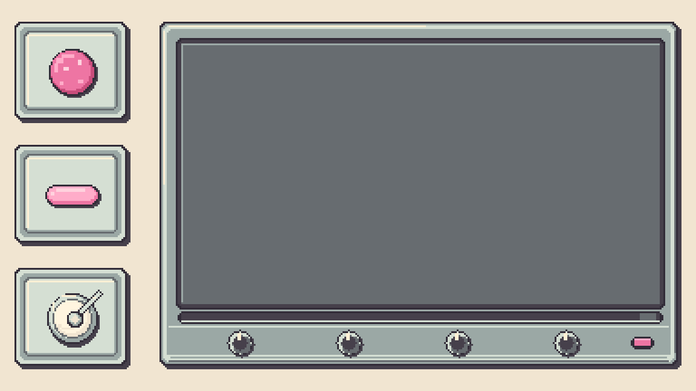

# Straight top-down grill station

Status: rejected visual direction, retained for comparison. The user requests the actual room grill proportions and cabinet front, checker floor and ingredients resting on a left counter. See the replacement `../grill-station-scene-v2/` and room-scale `../grill-station-ingredients-v2/` sources. This earlier menu composition is not the current target.

One new close-up working view for the grill station, in the approved rose/cream/plum/chrome pixel style. This is separately drawn station art, with an uninterrupted charcoal plate, a stainless horizontal surround, a shallow grease channel, four top-facing physical knobs and a small rose badge. There is no visible cabinet front. Existing room artwork and the `/grill` prototype remain unchanged.

## Editable sources

| Source                | Native dimensions | Named layers | Purpose                                                                                                 |
| --------------------- | ----------------- | ------------ | ------------------------------------------------------------------------------------------------------- |
| `grill-topdown.pxo`   | 288×192           | 6            | Bare reusable grill with separate shadow, horizontal steel, plate, channel, knobs and reflections/badge |
| `ingredient-tray.pxo` | 64×56             | 3            | One reusable empty tray; shadow, recessed steel and reflections                                         |
| `grill-station.pxo`   | 384×216           | 6            | Derived composition; optional warm background, grill, trays and each independent raw ingredient         |

All three native projects have the original fourteen-swatch palette, one static frame at 1fps, duration multiplier 1, and a matching `*-static` tag. The named palette is retained in `palette.json` and embedded in each `.pxo`. Solid integer clusters, one-pixel plum contours and upper-left reflections use only the approved colors. `grill-station-preview.png` is an exact 1152×648 nearest-neighbor 3× review image.

The three [raw ingredient sprites](../grill-raw-food-review/README.md) remain independent 40×40 images, placed at native 1× in the derived station only. Their artwork is not baked into the reusable grill or empty tray. One illustrated ingredient on a tray conveys the choice, without defining stock quantities.

## Art assembly

Origins use upper-left pixels; all dimensions below are art bounds, not gameplay rules.

| Part                   | Station origin       | Native size |
| ---------------------- | -------------------- | ----------- |
| Bare grill             | 88, 12               | 288×192     |
| Reused empty trays     | 8, 12; 8, 80; 8, 148 | 64×56 each  |
| Raw patty              | 20, 20               | 40×40       |
| Plain sausage          | 20, 88               | 40×40       |
| Batter bowl with ladle | 20, 156              | 40×40       |

The plate bounds are `(12,12,264,144)` relative to the grill, or `(100,24,264,144)` in the station. Its single-row upper/left reflected edge leaves an uninterrupted dark interior at `(13,13,263,143)` relative to the grill. These bounds only describe the visible art. Placement rules, capacity, collision, interaction targets, highlights and timers remain unset and engine-owned. No fixed cooking slots, labels, quantities, cooked food or additional machinery are drawn.

## Export and reproduce

[Native exports and assembly metadata](../../../apps/web/public/art/grill-station-closeup-review/README.md) include the complete bare grill, the reusable empty tray, three full-size grill material components, an optional background, both derived station variants, and a component atlas. Source `.pxo` files are the editable authority; PNG components provide independent reuse.

Execute `create-and-verify.gd` through Pixelorama MCP with absolute `source_dir`, `output_dir`, `food_dir`, and `food_names: ["raw-patty.png", "raw-sausage.png", "pancake-batter.png"]`. The food directory is `apps/web/public/art/grill-raw-food-review`. It compiles `draw.gd`, creates private native Project objects, copies the open approved `back-grill` palette/tag class, draws semantic cels, saves each explicit target, and returns JSON only. It never selects, resizes, renames or closes a foreign project; the bound foreign image is preserved.

The helper reopens each actual saved PXO ZIP, checks all full-size RGBA cels, metadata and palette, reconstructs the composite and compares it with its native PNG. It also reconstructs the grill from steel/plate/hardware components and the station from optional background plus the transparent assembly. `verification.json` records exact matches, all populated layers, successful exports, zero semitransparent/orphan pixels and preserved foreign state. A separate browser check reconstructed the 384×216 composition from its native grill, tray, food and background exports with zero mismatched RGBA bytes and verified the exact 3× preview.

This request stops at close-up art and a preview. No station behavior, runtime menu, world integration, cooked/burned states or other station designs are included.
