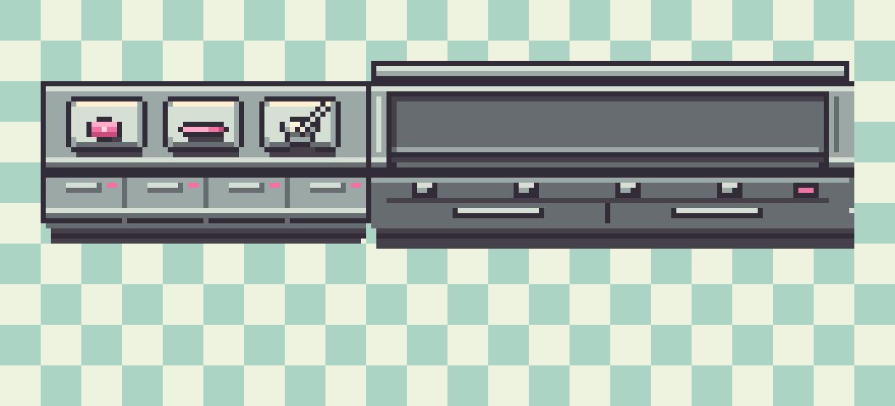

# Grill station kitchen scene

Accepted station scene following the user's actual kitchen references: the real room grill and adjacent steel counter remain at the same native pixel scale, with visible cabinet fronts and mint/cream checker floor in front. This replaces the flat menu composition; earlier art remains preserved. The user subsequently authorized main-game entry: a nearby outline, E to open, ingredient hover/focus and Escape/Back to close. The existing PNGs are reused without pixel changes; placement/cooking are not integrated. See the [view adapter](../../../apps/web/src/front-of-house/README.md).

`grill-station-scene.pxo` is 176×80, with fifteen populated named layers, a sixteen-swatch palette and one static frame at 1fps / duration multiplier 1, tagged `grill-station-scene-static`. It retains the seven original [accepted 96×40 grill](../kitchen-grill-scale-review/README.md) layers pixel-for-pixel at `(72,11)`. Other editable layers separate the unchanged native floor, counter shadow, counter top, cabinet fronts/plinth, reusable trays and each independent ingredient.

`ingredient-tray.pxo` is a separate 16×12 reusable empty tray with three populated layers, the original fourteen-swatch kitchen palette and one static frame at 1fps / duration multiplier 1, tagged `ingredient-tray-static`. The scene palette in `palette.json` contains those original fourteen swatches followed by the two unchanged floor colors. No new colors are introduced.

## Native assembly

| Piece                                               | Native size                    | Scene origin        |
| --------------------------------------------------- | ------------------------------ | ------------------- |
| Repeated original checker tile                      | 16×16                          | Grid origin 0,0     |
| Accepted left counter assembly                      | 64×32 including contact shadow | 8,16                |
| Exact accepted grill                                | 96×40                          | 72,11               |
| Reusable empty tray                                 | 16×12                          | 13,19; 32,19; 51,19 |
| Independent raw patty / sausage / batter bowl+ladle | 12×10 each                     | 15,20; 34,20; 53,20 |

The accepted [counter modules](../kitchen-counter-scale-review/README.md) supply the left end and three repeating top/front sections, with no closed right endcap at the grill join. The shared worktop begins at scene y16; the cabinet fronts begin at y34; both base contact rows are y46. Counter depth remains 18px, cabinet height 10px and plinth 3px. Grill and counter widths and all native pixels are preserved. Food remains independent [native room-scale art](../grill-station-ingredients-v2/README.md), at tray-local offset `(2,1)`.

All pieces use 1× native scale. Only the complete scene is enlarged, with exact nearest-neighbor 6× output at 1056×480. The scene shows no labels, fixed cooking slots, menu frame, player or cooked food. The bare cooking plate stays empty.

## Reproduce and verify

Run `create-and-verify.gd` through Pixelorama MCP with absolute `source_dir`, `output_dir`, `art_root` and `assets_root` parameters. `art_root` is `apps/web/public/art`; `assets_root` is `assets/pixelorama`. The recipe reads the actual approved grill PXO ZIP, copies its seven raw native cels without resizing or repainting, assembles accepted counter PNG crops and original floor tiles, draws the small reusable tray, and imports the separately authored 12×10 ingredient PNGs. It creates and saves private explicit native Projects and returns JSON only; no unrelated tab is selected, closed or mutated.

[Public PNGs and art-only assembly metadata](../../../apps/web/public/art/grill-station-scene-v2/README.md) accompany the sources. `verification.json` confirms each actual saved ZIP cel matches its authored layer, saved-source composites match PNGs, all seven original grill layers are unchanged, independent native components reconstruct the scene exactly, all layers are populated, all exports succeed, and there are zero semitransparent or out-of-palette pixels. The previously active Pixelorama project and its bound image remain unchanged. The enlarged preview was visually inspected.

Art bounds do not define collision, ingredient stock, cooking capacity, placement rules or timers. The separate runtime adapter now owns validated grill entry and procedural outline/hover feedback; food placement/cooking and `/demo` changes remain deferred.
