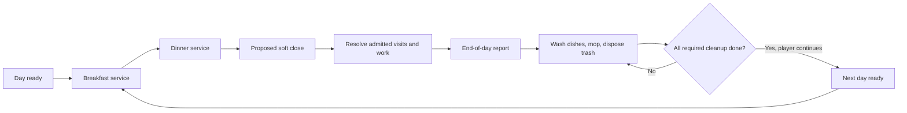
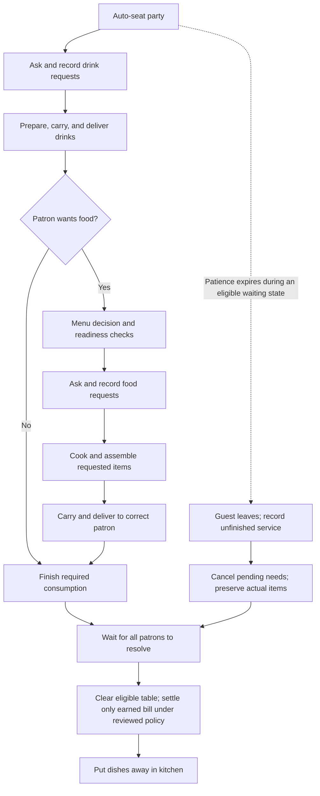

# Gameplay flow and connected systems

Status: review draft, not implemented. See [authority labels and navigation](README.md) and [review decisions](review-decisions.md). “Requirement” below means the supplied gameplay brief; “proposal” means a recommendation awaiting approval. Explicit chat decisions override either.

## 1. Player experience and approved scope

The player is one diner worker who takes orders, cooks at specialized stations, and carries prepared items to customers. The central challenge is choosing what to do next while balancing accuracy, cooking quality, and waiting time. Cooking is the main mechanic; walking and customer service connect the individual cooking tasks into a day.

User-confirmed v1 mode: **single player**, with architecture that can later support online co-op. User-confirmed controls: **WASD/arrows** for movement, **E** to interact, and **pointer input** for station tasks. The current deliverable is documentation only. There is no permission to begin assets or engine implementation until review.

Further user-confirmed rules: **service continues inside notepad/cooking panels; only the dedicated Pause menu stops time**. Dining room and kitchen are **separate views joined by a doorway**. A customer whose waiting tolerance expires **leaves**, with unfinished service recorded and a recoverable seating state.

The world uses the first reference's readable overhead diner arrangement with visible object fronts, rather than the second reference's side-on camera. The second reference contributes warm neon, plum/indigo shadows, teal fixtures, amber light, and lived-in diner details. The layout must support movement, station access, booth service, stool seating, entry/exit, cleanup, and visual occlusion independently of its decoration.

## 2. System map

| System                     | Owns                                                                          | Receives from / produces for                                          |
| -------------------------- | ----------------------------------------------------------------------------- | --------------------------------------------------------------------- |
| Day director               | Day phase, service clock, active menu, scheduled events, closing guard        | Starts arrivals; freezes a report; unlocks cleanup/next day           |
| Seating/customer lifecycle | Parties, patrons, seats, arrival/exit paths, decision readiness, eating state | Requests service; consumes delivery results; leaves table settlement  |
| Order/notepad              | Customer requests and automatically recorded complete table tickets           | Supplies recipe goals; tracks fulfillment, corrections, cancellations |
| Station/cooking            | Work-in-progress recipes, task input, cook/quality state, ready items         | Produces uniquely owned food/drinks or discardable failures           |
| Carry/service              | Tray inventory, clean/dirty item ownership, delivery target                   | Moves prepared items to patrons; retrieves dirty dishes               |
| Payment/reputation         | Bill, tip, service outcome, collection ledger                                 | Receives complete/clear transaction; supplies report snapshot         |
| Mess/cleanup               | Spills, floor trash, dirty-dish storage, disposal state                       | Affects service environment; gates next-day readiness                 |
| Presentation/input         | World rendering, feedback, focus, station/notepad/report screens              | Sends player intentions; displays outcomes without owning game truth  |

The systems exchange validated commands and domain events rather than reaching into each other's UI or sprite objects. The [engine plan](engine-design.md) specifies those boundaries. Their presence in this table does not imply code currently exists.

## 3. Day-level state flow

| Phase               | Player and world behavior                                                                                           | Exit condition                                                                                                            |
| ------------------- | ------------------------------------------------------------------------------------------------------------------- | ------------------------------------------------------------------------------------------------------------------------- |
| `day_ready`         | Proposed day briefing: active menu, anticipated rush/deal, readiness to start. No arrivals or service-clock advance | Explicit Start day command; prior cleanup is complete                                                                     |
| `breakfast_service` | Customers arrive and seat; drink-first service, breakfast recipes, normal station concurrency                       | Configured breakfast-to-dinner transition                                                                                 |
| `dinner_service`    | Same service responsibilities, dinner catalog, arrivals/events continue                                             | Configured closing time                                                                                                   |
| `closing_service`   | Proposed soft close: stop new arrivals; finish existing parties and put away dishes                                 | Every admitted party exits, all table settlements resolved, no carried delivery/dirty dishes or unresolved active cooking |
| `report`            | Required money/five-star report; proposed first access to the confirmed end-of-day right-side Upgrades button       | Player acknowledges report                                                                                                |
| `cleanup`           | Required dishwashing, mopping spills, collecting floor trash; proposed continued access to the end-of-day shop      | Every required task complete; no loose/carried refuse or dirty dishes; player chooses Continue                            |
| `next_day_ready`    | Proposed transition into the next day's briefing and any approved between-day choices                               | Next day's explicit Start command                                                                                         |

Breakfast → dinner and report → cleanup are brief requirements. A pre-day briefing, soft close, explicit guards, and off-clock cleanup are proposals. The brief does not specify clock duration, transition time, or whether a hard cutoff ends unfinished service; these are review decisions.

User-confirmed addition (2026-11-07): upgrades are bought during end of day through a small right-side **Upgrades** button. Proposed placement spans report and cleanup; the menu is optional and does not replace either phase. See [end-of-day upgrades](upgrades.md) for station possibilities, purchase behavior and unresolved details. This is design only.

Proposed transition rule: changing menus changes **new food orders**, not an already accepted ticket. An unfinished breakfast request remains cookable until resolved. Each ticket retains the recipe definition/version accepted at order time. This avoids impossible orders when the menu changes while a player is walking. Decide whether customers already browsing retain their earlier menu; the recommended default is to bind the menu when the food request becomes ready.

## 4. Movement, world interaction, and input ownership

User-confirmed movement is keyboard-based. Proposed behavior: continuous movement with normalized diagonal input, a small collision footprint at the worker's feet, and facing direction updated by movement. Movement cannot pass through furniture, station bodies, walls, or occupied blocking geometry.

E targets one nearby reachable interaction anchor, not every object whose image overlaps the worker. The proposed resolver considers distance, facing, walkable-side access, and a stable tie-break. The selected target gets a clear outline/marker and a short verb such as **Ask**, **Use grill**, **Pick up**, **Serve**, **Collect**, **Put away**, or **Mop**. An unavailable action explains why: full tray, station occupied, patron still eating, wrong service stage, or blocked access.

Proposed priority: the explicit focused target wins; otherwise a valid interaction for the held item/context wins, then nearest reachable target. Do not silently choose a table behind a wall or transfer an item to whichever customer happens to be nearest. The engine plan will define one consistent target-selection rule, rather than leaving this to sprite overlap.

Opening a station/notepad transfers input ownership to that UI. Proposed: worker movement stops, held movement keys are cleared, E cannot retrigger beneath the panel, and Escape returns to the world. The player may leave a cooking station while its timed process continues if that station supports unattended cooking. A hold-to-mix/pour task requires live input while active. **Confirmed:** customer timers and other cooking keep running while these panels are open. The dedicated Pause menu stops simulation time; opening a task panel is not a pause.

The DOM owns readable instructions, focus, buttons, and accessible controls. The world renders characters, furniture, item state, and contextual service icons. Tapping a DOM button must not also activate the world beneath it. Touch controls are not included in the confirmed v1 scope.

### Two connected room views

**Confirmed:** dining room and kitchen have separate views connected by a doorway. Proposed: both rooms belong to one continuously running day/session. Crossing the threshold changes the worker's room/entry position and the active camera/rendered room; it does not unload customer or station simulation. Customers still wait/eat/leave while the worker is cooking in the kitchen, and food keeps cooking while the worker is in the dining room.

The doorway has explicit approach zones, an exit/entry pair, and a safe destination footprint. Preserve carried items, open tickets, day phase, station processes, customer paths, and event history through the transition. Clear held movement/task input to prevent accidental immediate re-entry. A brief visual transition must not silently pause service or advance it twice. Preload both required room asset sets before service starts, so a loading stall is not a timing mechanic.

Proposed offscreen feedback: persistent HUD cues identify a ready order, urgent patron, or ready/burn-risk station with its room and target. Keep these concise and distinguish urgency by icon/text, not only color. Exact information/difficulty assistance is a review choice. The kitchen door must remain reachable during service and cleanup; room layouts must not strand the worker behind seating or an occupied station.

## 5. Arrival, seats, and party ownership

Requirement: customers walk in and seat themselves automatically. Available seating includes booths and round bar stools. A table may have multiple people and multiple orders.

Proposed data distinction:

- A **patron** owns their request, readiness, delivered items, eating progress, and service experience.
- A **party** owns the shared visit, seating assignment, and completion check.
- A **seating group** is either a booth/table or one bar-stool position for a solo patron, unless grouped bar seating is later requested.
- A **seat** is reserved before the arrival path begins, so two customers cannot independently take it.

Proposed arrival sequence: find a fitting available group → reserve it → walk along a navigable route → occupy assigned seats → show drink-order service cue. If the entrance or service path is blocked, retry or resolve through a defined arrival policy. Do not spawn a customer inside furniture. Party size, sharing, queues, turnaways, and doorway congestion remain review/tuning questions.

No party is spawned into a dirty/reserved/occupied seating group. A decorative booth's drawn width is not its seat capacity; capacity is explicit metadata. Once a party is assigned, stable party/patron/seat identifiers survive all orders, deliveries, and table clearing.

## 6. Drinks-first customer flow

| State                 | Player-facing cue                                           | Trigger / next state                                                                                         |
| --------------------- | ----------------------------------------------------------- | ------------------------------------------------------------------------------------------------------------ |
| Arriving/seating      | Walking/seated animation; not yet interactable for ordering | Arrives at reserved seat → drink request ready                                                               |
| Drink request ready   | Distinct order-needed icon                                  | Worker approaches + E → drink dialogue/notepad                                                               |
| Drink ticket recorded | Pending-order cue and ticket                                | Whole table finishes speaking; ticket records automatically; cooking/pouring begins when player uses station |
| Waiting for drinks    | Waiting/concern feedback, accessible text                   | Correct delivery satisfies required drink lines                                                              |
| Looking at menu       | Different thinking/menu icon; not the same as order-ready   | Decision timer / visit intent → food request ready, or drink-only completion                                 |
| Food request ready    | Order-needed icon again, clearly tied to food course        | Worker approaches + E → food dialogue/notepad                                                                |
| Waiting for food      | Ticket-linked wait state                                    | Deliver requested food lines                                                                                 |
| Eating/drinking       | Consumption feedback                                        | Required consumption for this patron ends                                                                    |
| Finished              | Patron finished but party may still be eating               | All patrons finished → party leaves and table is ready to clear                                              |

The brief's “next round” is interpreted as the **next service interaction/course within the same day**, not a second day or reset. The brief says some patrons order only a drink. Proposed: that intent is determined at visit creation and becomes visible after their drink service, so the worker knows no food ticket is needed. Confirm whether food can be requested before the drink is delivered; the draft recommends drink delivery before the menu/food stage for a clear drink-first loop.

The whole party must finish before collection; a fast-eating patron does not free their table while companions still need service. Different patrons can request different items, have different decision times, and finish at different times. Their party remains one shared seating/settlement unit.

The abandonment arrow summarizes a transition available from each approved patience-controlled state, not only the seating step. Its partial-bill/companion policy remains open. Normal finished visits follow section 10; abandonment must not run a full successful settlement by default.

**Confirmed abandonment branch:** an impatient customer can leave before normal completion. Record the unfinished visit/request and cancel that patron's outstanding fulfillment needs without marking them successfully served. Proposed: a patron's departure does not evict companions automatically; the shared seating remains occupied until the remaining patrons finish or leave. Then it enters a recoverable clearing state. Already prepared or carried food remains a real item; it does not disappear because its intended recipient left. Which delivered items are charged and whether a party leaves together are unresolved accounting/party-policy questions.

## 7. Automatic table dialogue and notepad

The latest user requirement replaces manual item selection/checkboxes and ticket confirmation. A ready table shows an outline and a simple `!` bubble whenever on screen, regardless of worker distance. Approach a table or one-person counter place and press E. The worker cannot move during the order. Each seated customer speaks in turn: food first, then separate topping symbols. After the entire captured table finishes speaking, its full request records automatically in the small read-only notepad and movement resumes. Repeated E cannot restart an active order or duplicate recorded patrons.

This is implemented as the main-game [order test](../../apps/web/src/game/customers/ORDERS.md). Main customers remain seated indefinitely. Six deterministic sample requests, 1.2 seconds per symbol and 0.3 seconds between people are provisional demonstration settings. The table captures currently seated guests; later arrivals may be ordered separately. Walking guests are not ready. Reset/restoration restarts the wave and clears transient tickets. No cooking, serving, eating, billing, persistence or automatic next stage follows recording.

Recipe availability, fulfillment checks, course progression, ticket correction and replay remain future design work. Manual transcription errors are no longer a player mechanic. Other sections describing drinks-first/full service remain design proposals, not implemented behavior of this order test.

## 8. Connected cooking workflow

Requirement: cooking is station-specific. The player can make mistakes/burn food and carry failed food to the trash. The [catalog](content-catalog.md) contains the exact listed recipes/options.

General proposed item lifecycle:

`not started → ingredient/configuration selection → active task → cooking/mixing/pouring → ready → carried on tray → delivered → consumed → dirty dish → dirty-dish drop-off → between-day wash`

Alternative failure path:

`in progress / ready → invalid or burned → picked up for disposal → trash → task/station capacity released`

Prepared food is not automatically assigned to or removed from a ticket. Each item stores its actual recipe/options, quality, container, unique ID, and current owner/location. The player may deliberately prepare matching items ahead of delivery if batching is approved. Shelf life, cooling, spoilage, and automatic discard are not brief requirements and are not assumed for v1.

Proposed station states are idle, configuring, active, ready, failed, and blocked. A station slot holds one work item unless its capacity says otherwise. A station can remain actively cooking while the worker goes elsewhere; active processes are simulation state, not timers that disappear when a modal closes. UI closure never awards progress, completes food, duplicates ingredients, or silently deletes an item.

### Milkshake

Requirement: choose vanilla/chocolate/strawberry base, click and hold to mix, then choose whipped cream/cherry/chocolate drizzle/cherry drizzle. A two-at-once upgrade is listed.

Proposed loop: select base → begin mixing → hold pointer to increase consistency progress → release to stop input → reach target band → choose requested toppings → mark ready for pickup. Whether overmixing fails, progress decays on release, or toppings have order/quantity constraints is undecided. Baseline recommendation: progress pauses on release and persists when leaving; no unrequested decay. Two-at-once must mean two explicitly tracked outputs, not a duplicate-pickup loophole.

### Grill: burgers and hot dogs

Latest user confirmation: timed flipping is required. Final ingredient selection should use clickable physical trays beside the grill. The separately authorized `/grill` demo uses ordinary ingredient controls and geometric shapes, as specifically requested, and tests only the grill process. Its one-flip model, six slots and numeric windows are provisional feel tuning; assembly, final art and restaurant integration remain unimplemented.

Requirement: grill burgers/hot dogs and support their listed toppings. A valid burger has at least a bun and patty; all/some/no optional toppings are valid.

Planned loop: click product in its ingredient tray → automatically place one in the first free grill spot/start timed cook → flip at the required time → take cooked protein → assemble the required bun/protein and optional toppings → mark ready. The user confirms a single click must add food immediately, without selecting an ingredient and then clicking the grill. Demo controls are temporary and will be replaced by game assets using this same action. Ready food left on heat can progress to burned if burning is enabled for that recipe. Final flip count, cook window, burn threshold, slot count, assembly location, and whether the same grill is shared with pancakes are open balancing/layout decisions. Do not invent burger doneness requests, allergens, or ingredient stock.

### Grill: pancakes

Requirement: one, two, or three pancakes; banana, chocolate, blueberry, and strawberry topping options.

Proposed: each pancake is one tracked grill sub-item; the finished plate requires the ordered count before pickup. A stack of three is one served dish with three pancakes, not three fulfilled ticket lines by accident. Topping combination rules and whether partially completed plates can wait off-heat need review. No syrup/butter requirement is inferred from artwork.

### Fryer

Requirement: fries; onion rings are an upgrade. The brief specifies no input task.

Proposed loop: select available product → lower basket → timed fry → lift within a ready window → portion into serving container → pickup. Leaving the basket down too long may create a burned batch; early pickup produces an underdone failure only if approved. Basket capacity and whether one batch creates multiple portions are open.

### Coffee machine

Requirement: pour coffee into cups. Hot chocolate and tea are upgrades. The brief gives no sugar/milk modifiers.

Proposed loop: choose unlocked drink → place cup → hold to pour to a visible target fill → release → ready/pickup. Overfill/underfill tolerance and recovery behavior need approval. Do not add temperature, foam, latte art, or sweetener orders without design review.

## 9. Tray pickup and delivery

Requirement: carry prepared food on a tray to its table. Proposed: the worker has a small finite tray measured by explicit serving slots. Each slot holds one plated item or drink; a pancake stack is one plated item. Capacity is a reviewed balance value, not implied by sprite size.

Pickup is an atomic transfer from a ready station/pass location to an empty valid tray slot. If the tray is full, nothing changes and the UI explains the failure. One item cannot simultaneously remain at a station and appear on a tray.

At a valid target seating group, E opens delivery selection when ambiguity exists: select a carried item and receiving patron/order line. For a single unambiguous compatible target, a quick action may be offered after review. Show the target name/seat and exact item before committing. Deliveries can be partial: one drink or dish fulfills only its matching quantity; the rest remain pending.

Proposed wrong-order treatment: the customer rejects a mismatched item with a clear reason; it stays on the tray and does not satisfy the line. A mistake can affect the service score if approved. Whether customers accept imperfect food at reduced rating, accept unordered extras, or require remake is open. A failed delivery must never delete food invisibly, consume a correct line, or award money.

Dirty dishes and edible items should not silently mix on the same tray. Proposed v1 default: either clean service mode or dirty-dish collection mode, with a blocked-action explanation until unloaded. If simultaneous carrying is preferred, define separate slots/types and visual feedback explicitly.

## 10. Eating, payment, clearing, and seating reuse

Requirement: wait until the whole person/table is done eating, collect the tip and dishes at the table, receive cash at that moment, then put dishes away. Dishes are **not washed during service**.

Proposed sequence:

1. All ordered consumption for every patron completes; no pending accepted course remains.
2. The party exits; the vacated seating group retains dirty dish props and a visible settlement/tip cue.
3. E on that group checks dirty-dish carrying capacity, then atomically collects its settlement and dishes. If capacity is insufficient, nothing is collected; the player can unload first. Partial clearing is a separate option requiring explicit rules.
4. Money is added once, with a ledger entry keyed to visit/settlement ID. Separate bill revenue and tip in accounting, even if one action collects both.
5. Dirty dishes are carried to the kitchen drop-off/rack. This is storage, not washing. Their count persists as the source for end-of-day wash tasks.
6. Proposed: the seating group becomes reusable after all dishes are removed from it; the player can still be walking to drop-off. If table wiping is wanted, specify it separately rather than inventing it.

The brief explicitly places cash receipt at clearing; it does not clearly distinguish bill collection from the visible tip. The draft treats **bill + tip** as one collection transaction, recorded separately for reporting. Confirm this interpretation. Do not pay on order entry, delivery, customer departure, and table collection as four separate rewards.

## 11. Special customers and environmental feedback

Archetypes modify the same lifecycle rather than bypassing its invariants. Their listed identities/behaviors are requirements; numerical multipliers, spawn weights, consequences, and combinations remain proposals.

| Archetype                                           | Required distinction                                              | Proposed readable feedback / connected systems                                                                         |
| --------------------------------------------------- | ----------------------------------------------------------------- | ---------------------------------------------------------------------------------------------------------------------- |
| Business customer                                   | Disrespectful to staff; needs orders quickly                      | Brief impatient dialogue, distinct patience cue; same order rules with shorter configured waiting tolerance            |
| Messy customer                                      | Drops trash/spills; unattended mess reduces other customers' tips | Visible mess entity with location/type; affected seated patrons respond through an approved environmental penalty rule |
| Slow decision maker                                 | Takes longer; worker needs to check readiness more often          | Menu/thinking state persists; check interaction gives clear “not ready” or ready response; no duplicate ticket         |
| Large-order customer (brief nickname “Bubble bass”) | Many food items, generous tip potential, stricter time            | Original character design/name proposed; more order lines and a clear demanding-service cue                            |

The brief nickname identifies a behavior, not permission to copy an existing cartoon character. Use an original guest design if approved.

Mess is real world state, not only a decal. Each spill/trash object has identity, position, clearance status, and cleanup interaction. Proposed: spills are readable obstacles/debuff sources only if a specific movement rule is approved; do not assume slipping, damage, or blocking collisions. Define whether tip penalties are per visible mess, proximity, exposure time, or a global cleanliness score. Avoid an arbitrary global penalty that the player cannot understand.

Trash from failed food and floor litter is different from dirty dishes. The attachment ends the trash sentence mid-thought (“Overtime the trash”), so bin capacity, emptying, smell, overflow, and collection are explicitly unresolved. No such mechanic should be implemented from that fragment.

## 12. Rush and newspaper events

Requirement: rushes occur at specific times; a newspaper deal can increase arrivals over the whole day.

Proposed: the day director owns a seeded schedule. A rush changes the arrival rate for a bounded interval and returns to the normal rate afterward. A newspaper deal is a day-level modifier with clear briefing/HUD notice. Neither spawns patrons directly into occupied seats or ignores capacity limits. Define whether both can overlap and how a deal affects prices; the brief confirms more customers but does not specify a discount amount or any revenue reduction.

Arrival RNG must be reproducible for tests and configurable for tuning. Do not reroll a special customer, seating choice, or event merely because the player reopens a modal. Exact spawn/queue limits remain open.

## 13. Ratings, tips, and the end-of-day report

Requirement: show all money made and customer rating out of five stars in an end-of-day menu. Mess can reduce tips; the large-order archetype tips well when served successfully.

Proposed accounting categories: collected sales, collected tips, gross collected cash, completed visits, item/order errors, and service outcomes. Ingredient cost, rent, wages, taxes, daily loss conditions, or a profit calculation are **not** specified and should not appear as settled mechanics.

Proposed rating contributors: accuracy against the actual request, cooking result, service wait, and cleanliness exposure. Show an understandable breakdown instead of a hidden formula. Store event timestamps/quality outcomes to derive ratings consistently; exact weights/tolerance/rounding are reviewed tuning data. Display a five-star scale without implying perfect precision from an arbitrary algorithm.

The report is a frozen snapshot of the completed service day. Opening/closing it cannot recollect payments or rerun scoring. Proposed: cleanup happens after this snapshot and gates the next day; it does not retroactively change past customers' ratings. **Confirmed:** purchases belong to end of day, opened through the small right-side Upgrades button. Propose making it available on the report and throughout cleanup, displaying spendable balance separately from completed-day earnings. Exact placement within end of day, costs and activation timing remain proposals in the [upgrade design](upgrades.md).

## 14. Mandatory cleanup and next-day readiness

Requirement: before starting another day, wash some dishes in the kitchen, clean spills, and pick up floor trash. Mid-service dish collection remains “put away,” not wash.

Proposed cleanup task ledger derives from unresolved world state plus stored dishes at closing. The player must wash the required stored-dish batch, mop remaining spills, collect remaining floor trash, and resolve any carried waste. There is no arbitrary daily quota or respawned mess unless approved. If the user intends “some dishes” as a fixed minigame sample instead of every dish count, that will replace the quantity rule after review.

Proposed cleanup interactions: walk to the sink and perform a short repeatable wash task; carry/drop floor trash at the bin; perform a hold/progress mop action at a spill. Exact task input and equipment carrying are open. The floor must visibly change when cleaned, and completing a task twice must not create extra progress or money.

Proposed cleanup is unhurried: service timers and customer spawning stop, while cleanup progress can continue. Next-day Start remains disabled with concrete remaining counts/actions, not a vague “not ready” message. Starting a new day requires an explicit command and an empty cleanup ledger. Reset day-local states; preserve only the progression/save data that the user approves.

Proposed shop integration: opening/closing Upgrades retains the cleanup ledger. Buying nothing is valid and buying something never clears a cleanup obligation. New capabilities activate for the next service day by proposal; owned upgrades persist with progression once that system is implemented.

## 15. Failure, interruption, and recovery rules

| Situation                          | Proposed outcome / invariant                                                                                                                                                                                                                                                        |
| ---------------------------------- | ----------------------------------------------------------------------------------------------------------------------------------------------------------------------------------------------------------------------------------------------------------------------------------- |
| Early/late cooking action          | Record actual quality/failure; retain an item to dispose or approved recoverable state                                                                                                                                                                                              |
| Interrupted order dialogue         | Discard partial dialogue without a partial ticket; release input ownership and permit a new order attempt                                                                                                                                                                           |
| Wrong delivery                     | Give reason; preserve item and pending line; no silent loss or duplicate fulfillment                                                                                                                                                                                                |
| Full station/tray/bin/drop-off     | Explain blocked action; leave state untouched; bin/drop-off limits are not yet specified                                                                                                                                                                                            |
| Not-ready customer                 | Show status and return to world; no fake order or patience reset                                                                                                                                                                                                                    |
| Customer runs out of patience      | **Confirmed:** customer leaves, unfinished service is recorded, seating is recoverable. Cancel pending needs without recording success; resolve remaining party members, dishes, and any bill under the reviewed accounting policy                                                  |
| Closing time with active customers | Proposed soft close/drain; no forced disappearance or impossible unresolved report guard                                                                                                                                                                                            |
| Leaving station/task               | Preserve station process and recipe state; release UI input only                                                                                                                                                                                                                    |
| Browser tab hidden                 | Unresolved visibility policy: a proposal is to enter the same dedicated Pause menu explicitly, rather than silently freeze outside it. Normal task/room transitions do not pause. Decide before implementing; future online play needs a different authority policy                 |
| Reload during day                  | User excludes mid-day recovery. The [save module](browser-save-plan.md) supports day-ready checkpoints and multiple slots; the future real day loop must load/save those boundaries. No route is wired to it yet; unfinished service/partial cleanup are outside the recovery scope |
| Repeated E/held click              | Edge-trigger interaction; accept a transfer/payment/transition at most once                                                                                                                                                                                                         |

No failure condition/game-over, overnight debt, or irreversible customer penalty is established by the brief. Recovery and tutorial assistance need review; every proposed penalty must teach the player how to recover.

## 16. Illustrative connected visit

This example demonstrates flow, not approved timing/pricing/balance values:

1. A two-person party reserves a booth and walks to its seats.
2. An order cue appears. The worker approaches, presses E and listens while the party states coffee and a strawberry shake with whipped cream; the full ticket records automatically.
3. The worker pours coffee and mixes/tops the shake, then picks up both into available tray slots and delivers them to their correct patrons.
4. One patron is ready for food; the other remains in menu/decision state. The worker checks again later rather than generating a duplicate ticket.
5. Their food requests are recorded separately. The worker cooks/assembles the items according to the active accepted menu and their actual requested modifiers, coordinating grill time with other customers.
6. The worker delivers each dish. One patron finishes first; the party still occupies its booth while the other eats.
7. The party leaves. The worker collects its settlement and dirty dishes once; collected sales/tips enter the day's ledger.
8. The worker puts the dishes in the kitchen's dirty-dish storage; no washing occurs during service. The booth becomes available under the reviewed clearing policy.
9. At the end of service, the report includes the visit. After report acknowledgment, remaining dishes/spills/trash become cleanup work; the next day cannot start until required tasks are complete.

## 17. Requirements coverage

| Brief/request topic                                   | Design location                          |
| ----------------------------------------------------- | ---------------------------------------- |
| Three worker jobs, balancing time and accuracy        | Sections 1–2, 7–10                       |
| Walk-up dialogue, spiral notepad, multiple orders     | Sections 4–7                             |
| Drinks first, menu wait, drink-only patrons           | Section 6                                |
| Breakfast then dinner                                 | Section 3; catalog/menu review questions |
| Specialized cooking, options, burn/discard            | Section 8; content catalog               |
| Tray service, full-table completion, cash/tips/dishes | Sections 9–10                            |
| Business/messy/slow/large-order guests                | Section 11                               |
| Timed rush and newspaper deal                         | Section 12                               |
| Five-star report and mandatory cleanup                | Sections 13–14                           |
| Modular reference-guided art                          | Art asset plan                           |
| Underlying interaction/event/rendering engine         | Engine design                            |
| Single player now, future co-op architecture          | Engine design and section 15             |

## 18. Approval boundary

The narrative is intentionally connected enough to review and later implement, but proposals are not approvals. Resolve the questions in `review-decisions.md`, approve a specific implementation slice, then begin code/assets. Until then, preserve the running foundation and its existing artwork unchanged.
